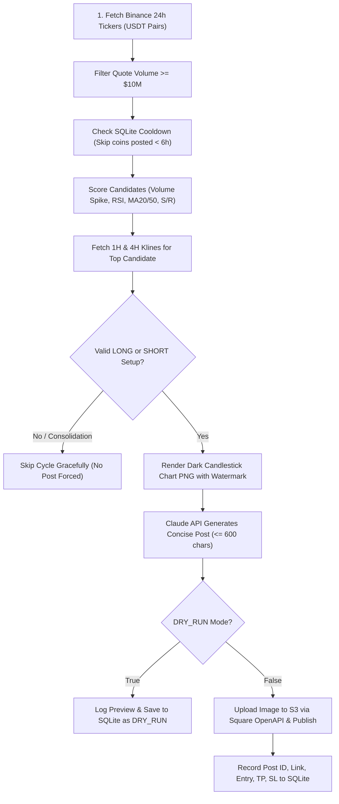

# 🚀 Automated Binance Square Posting Bot - Talha Sniper

An enterprise-grade, fully automated backend bot that runs every 30 minutes, monitors live Binance crypto market data, selects high-probability trading opportunities using strict rule-based technical analysis, generates professional dark-theme candlestick charts, drafts high-converting technical posts via the Anthropic Claude API, and publishes directly to your **Binance Square** creator account via the Binance Square OpenAPI.

---

## 📑 Table of Contents
1. [Core Features](#-core-features)
2. [Architecture & Pipeline](#-architecture--pipeline)
3. [Safety & Compliance Rules](#-safety--compliance-rules)
4. [Project Structure](#-project-structure)
5. [Prerequisites](#-prerequisites)
6. [Quickstart / Local Setup](#-quickstart--local-setup)
7. [Ubuntu VPS Deployment Guide](#-ubuntu-vps-deployment-guide)
   - [Option A: Production Systemd Service (Recommended)](#option-a-production-systemd-service-recommended)
   - [Option B: System Cron](#option-b-system-cron)
8. [CLI Commands & Controls](#-cli-commands--controls)
9. [Error Codes & Troubleshooting](#-error-codes--troubleshooting)
10. [Signal Performance Tracking](#-signal-performance-tracking)

---

## 🌟 Core Features

- **Rule-Based Market Scanner**: Automatically pulls all 24h ticker pairs against USDT from the Binance public API (no key required for public market data) and filters out illiquid pairs below a configurable quote volume (e.g. $10M+ USDT).
- **Technical Indicator Scoring**: Evaluates volume spikes against 20-period moving average volume, price momentum, 1H/4H MA20/MA50 positioning, 14-period RSI, and support/resistance reactions.
- **6-Hour Coin Cooldown (Deduplication)**: SQLite-backed state prevents repetitive posting of the same coin within 6 hours.
- **No-Trade Filter**: If market conditions indicate consolidation or lack of a clean Risk/Reward setup ($\ge 1.4$), the bot skips the cycle gracefully instead of forcing a low-quality post.
- **Dark-Theme Candlestick Charts**: Uses `mplfinance` with custom Binance-style dark theme (`#181a20`), moving average overlays (MA20 & MA50), key Support/Resistance levels, Target (TP), Stop-Loss (SL), and an elegant `"Talha Sniper"` watermark.
- **Anthropic Claude Integration**: Uses Claude 3.5 Sonnet to draft concise, high-converting posts (strictly $\le 600$ characters) with varied tone, bullet points, coin cashtag (e.g., `$SOL`), setup rationale, entry zone, target, and stop-loss. Concludes with actionable Call-to-Actions (CTAs) to drive trade executions.
- **Official Binance Square OpenAPI Flow**: Compliant with `binance/binance-skills-hub` reference specifications:
  - Generates presigned S3 upload URL (`/image/presignedUrl`)
  - Direct S3 binary payload upload
  - Polls image processing status (`/image/imageStatus`)
  - Publishes content with attachments (`/content/add`)
  - Full support for 504 Gateway Timeout handling
- **Graceful Daily Limit Protection**: Enforces Binance Square's 100 posts/day limit (error `220009`), tracking daily counts in SQLite and halting gracefully.
- **Dry-Run Mode**: Full simulation capability to verify scanner, chart rendering, and AI drafting without publishing live to Binance Square.
- **Signal Accuracy Tracking**: Evaluates past signals against subsequent high/low klines to record if Target or Stop-Loss was triggered first and logs realized PnL %.

---

## 🔄 Architecture & Pipeline

Every 30 minutes, the bot executes an 8-step pipeline:



---

## 🔒 Safety & Compliance Rules

1. **Posting-Only API Key**: Your Binance Square OpenAPI key must **NEVER** have Trading or Withdrawal permissions enabled.
2. **Deterministic Rules**: All trade decisions (entry, target, stop loss, direction) are strictly computed by rule-based algorithmic math. The AI never guesses numbers—it only formats the computed numbers into crisp copy.
3. **Secrets Management**: All API keys and credentials are read strictly from environment variables or a `.env` file; never hardcoded in source control.
4. **Resilience & Backoff**: Retries network requests up to 3 times with exponential backoff. A single API timeout will never crash the scheduler.

---

## 📁 Project Structure

```
binance-automation/
├── config/
│   ├── __init__.py
│   └── settings.py              # Environment configuration & default values
├── src/
│   ├── __init__.py
│   ├── binance_client.py        # Public Binance API client (tickers, klines, retry)
│   ├── market_scanner.py        # Volume spike, RSI, MA, S/R coin scoring
│   ├── technical_analysis.py    # 1H/4H multi-timeframe analysis & trade setup engine
│   ├── chart_generator.py       # mplfinance dark-theme charts + "Talha Sniper" watermark
│   ├── ai_writer.py             # Claude API prompt engineering & template fallbacks
│   ├── square_publisher.py      # Binance Square OpenAPI client & S3 uploader
│   ├── database.py              # SQLite state, 6h deduplication & signal tracking
│   ├── performance_tracker.py   # Signal accuracy evaluator (TP vs SL hit)
│   ├── notifier.py              # Webhook alert dispatcher (220003, 220004, 220009)
│   └── bot.py                   # Main posting pipeline orchestrator
├── tests/
│   ├── __init__.py
│   ├── test_database.py         # SQLite tests (cooldown, daily counts, signals)
│   ├── test_technical_analysis.py# RSI, ATR, S/R level calculations
│   ├── test_chart_generator.py  # Candlestick image generation tests
│   ├── test_ai_writer.py        # Post character limits & disclaimer tests
│   └── test_square_publisher.py # Square publishing & error code handling
├── charts/                      # Auto-generated candlestick chart PNG files
├── data/                        # SQLite database storage (square_bot.db)
├── logs/                        # Rotating log files (square_bot.log)
├── systemd/
│   └── binance-square-bot.service # Production systemd service definition
├── .env.example                 # Configuration template
├── requirements.txt             # Pinned Python package dependencies
├── main.py                      # Main entrypoint & APScheduler daemon
└── README.md                    # System documentation & deployment guide
```

---

## 🛠 Prerequisites

- **Python 3.11+**
- **Git**
- **Binance Square OpenAPI Key** (obtained from Binance Square Creator Center; strictly posting-only)
- **Anthropic API Key** (for Claude 3.5 Sonnet copy drafting)

---

## ⚡ Quickstart / Local Setup

1. **Clone the repository**:
   ```bash
   git clone <repo-url> binance-automation
   cd binance-automation
   ```

2. **Create a virtual environment & install dependencies**:
   ```bash
   python3 -m venv venv
   # On Linux/macOS:
   source venv/bin/activate
   # On Windows PowerShell:
   .\venv\Scripts\Activate.ps1

   pip install -r requirements.txt
   ```

3. **Configure environment variables**:
   ```bash
   cp .env.example .env
   ```
   Edit `.env` and fill in your keys:
   ```env
   BINANCE_SQUARE_OPENAPI_KEY=your_square_openapi_key_here
   ANTHROPIC_API_KEY=your_anthropic_api_key_here
   DRY_RUN=true
   ```

4. **Run the test suite**:
   ```bash
   pytest -v
   ```

5. **Execute a single dry-run test**:
   ```bash
   python main.py --run-once --dry-run
   ```

---

## 🌐 Ubuntu VPS Deployment Guide

Deploying on an Ubuntu 22.04 or 24.04 VPS ensures your bot runs 24/7 without interruption.

### 1. Initial VPS Setup
SSH into your server and install Python, pip, and required system libraries:
```bash
sudo apt update && sudo apt upgrade -y
sudo apt install -y python3 python3-pip python3-venv git
```

### 2. Clone the Repository
```bash
cd /home/ubuntu
git clone <your-repository-url> binance-automation
cd binance-automation
```

### 3. Setup Virtual Environment
```bash
python3 -m venv venv
source venv/bin/activate
pip install --upgrade pip
pip install -r requirements.txt
```

### 4. Configure Production Environment
```bash
cp .env.example .env
nano .env
```
Ensure:
- `BINANCE_SQUARE_OPENAPI_KEY` is your active posting key.
- `ANTHROPIC_API_KEY` is your Claude API key.
- Set `DRY_RUN=false` once you are ready for real publishing.

---

### Option A: Production Systemd Service (Recommended)

Systemd automatically manages the bot in the background, starts it on server boot, and restarts it if the server ever reboots.

1. **Copy the service file**:
   ```bash
   sudo cp systemd/binance-square-bot.service /etc/systemd/system/
   ```

2. **Reload systemd daemon**:
   ```bash
   sudo systemctl daemon-reload
   ```

3. **Enable and start the bot service**:
   ```bash
   sudo systemctl enable binance-square-bot
   sudo systemctl start binance-square-bot
   ```

4. **Check status & live logs**:
   ```bash
   sudo systemctl status binance-square-bot
   
   # View live logs in real time:
   tail -f logs/square_bot.log
   ```

5. **Stop / Restart Service**:
   ```bash
   sudo systemctl stop binance-square-bot
   sudo systemctl restart binance-square-bot
   ```

---

### Option B: System Cron

If you prefer using cron rather than a persistent daemon, you can trigger single-cycle executions (`--run-once`) every 30 minutes:

1. Open your crontab editor:
   ```bash
   crontab -e
   ```

2. Add the following entry:
   ```cron
   */30 * * * * cd /home/ubuntu/binance-automation && /home/ubuntu/binance-automation/venv/bin/python main.py --run-once >> /home/ubuntu/binance-automation/logs/cron.log 2>&1
   ```

---

## 🎮 CLI Commands & Controls

The CLI provides flexible commands for management and diagnostics:

| Command | Description |
| :--- | :--- |
| `python main.py` | Runs continuous 24/7 background scheduler (30-min intervals). |
| `python main.py --run-once` | Executes exactly one scanning and posting cycle immediately, then exits. |
| `python main.py --dry-run` | Runs in simulation mode; generates charts and post drafts without calling Square API. |
| `python main.py --run-once --dry-run` | Runs a single simulation cycle. Ideal for verification. |
| `python main.py --summary` | Prints and alerts today's post counts, coins handled, and status. |
| `python main.py --stats` | Displays historical accuracy, win-rate %, target hits, stop hits, and PnL metrics. |
| `python main.py --history` | Displays a table of the 15 most recent signals and their live outcomes. |
| `python main.py --track-signals` | Manually triggers evaluation of open signals against recent prices. |
| `python scripts/health_check.py` | Runs automated self-test diagnostics of APIs, SQLite, and chart engine. |

---

## ⚠️ Error Codes & Troubleshooting

The bot automatically identifies and manages Binance Square OpenAPI error codes:

| Error Code | Description | Automated Bot Behavior |
| :--- | :--- | :--- |
| **`000000`** | Success | Post published; ID and link logged to SQLite. |
| **`220003`** | API Key Not Found | Logs critical error and dispatches alert. Check key in `.env`. |
| **`220004`** | API Key Expired | Logs critical alert. Generate a new key in Square Creator Center. |
| **`220009`** | Daily Post Limit (100) Reached | Bot logs warning and pauses further posts until midnight UTC. |
| **`504`** | Gateway Timeout on `/content/add` | Handled as submitted without crashing; logged with special status. |

---

## 📈 Signal Performance Tracking

The bot includes an optional performance tracking engine:
- Every published setup records `entry_price`, `target_price`, and `stop_loss`.
- A background job periodically checks high/low klines for open signals over the subsequent 7 days.
- When `high >= target` (for LONG) or `low <= target` (for SHORT), it marks `TARGET_HIT` with realized PnL %.
- If `low <= stop_loss` (for LONG) or `high >= stop_loss` (for SHORT), it marks `STOP_HIT`.
- This allows real-world auditing of your signal accuracy and hit rates directly from the SQLite database.
